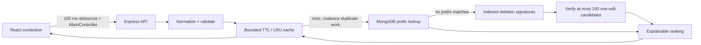

# Typeahead · Low-Latency Autocomplete Service

A full-stack autocomplete project built with **React, Node.js, and MongoDB**. Search a curated software-engineering vocabulary with indexed typo recovery, explainable ranking, bounded caching, Prometheus metrics, and reproducible scale tests.

Try **`reaxt` → React**, toggle **Allow one typo**, and open **Explain this search** to inspect the result.


[See the ranking inspector](docs/inspector.png) · [Read the design decisions](docs/DESIGN.md) · [Inspect benchmark evidence](BENCHMARKS.md)

## Run locally

Requires Node.js **22.12+** (Node 22 LTS recommended) and Docker for MongoDB, or a MongoDB connection string.

```sh
npm ci
cp .env.example .env
docker compose up -d
npm run seed
npm run dev
```

Open the Vite URL printed in your terminal (usually http://localhost:5173). The API runs on http://127.0.0.1:3001. To use an existing database, set `MONGODB_URI` and `MONGODB_DB` in `.env` before seeding. Keep credentials out of Git.

Without MongoDB, an explicitly labelled demo is available:

```sh
DEMO_MODE=true npm run dev
```

Demo storage is in memory. It is useful for exploring the UI; it does not verify MongoDB performance. The server fails startup if MongoDB is unreachable in normal mode; it never silently substitutes demo data.

## Build and serve

```sh
npm run build
npm start
```

The Node server serves the compiled React app and API on port 3001. It binds to loopback by default. A public deployment needs a reverse proxy, TLS, authentication if appropriate, rate limiting, and a managed MongoDB instance; this repo does not provision those. GitHub Pages cannot run the Node/MongoDB backend.

## API

```http
GET /api/suggest?q=react&limit=8
GET /api/suggest?q=reaxt&fuzzy=true
GET /api/health
GET /api/metrics
```

Suggestion responses include `query`, `items` (`id`, `label`, `category`, `score`), `cache` (`hit`, `miss`, `coalesced`, or `none`), `search` (strategy, candidate count, retrieval and ranking timing), `durationMs`, and `storage`. `Server-Timing` exposes server search duration. The UI separately measures HTTP round trip; neither number includes the 100 ms debounce or React paint. Empty input returns no suggestions. Limits are integers 1–10; normalized queries cap at 64 characters. Invalid input returns 400, saturation returns 503, and database errors return a safe 500 response.

`/api/metrics` exposes Prometheus text with fixed-cardinality counters, gauges, and server-duration buckets. It records no query text or user identifiers. Metrics and cache are per process.

## How it works



- **Indexed retrieval:** Seeded documents contain normalized phrase and word prefixes. `{ prefixes: 1, popularity: -1, id: 1 }` supports equality on a multikey prefix followed by popularity ordering. Queries never interpolate regex or MongoDB operators from user input. Integration tests check for index scans using `explain()`.
- **Ranking:** Exact matches score above phrase prefixes, which score above word prefixes. Log popularity and alphabetical ordering break ties. At most 200 popularity-sorted prefix candidates plus one indexed exact-match recovery are ranked in application code. Match tiers dominate a bounded popularity boost, even at extreme popularity values. Each result includes a match type, matching prefix, edit distance, and popularity contribution.
- **Typo recovery:** If strict prefix search returns nothing, 3–24 character queries use a separate MongoDB index of symmetric deletion signatures. At most 100 candidates are verified for a single insertion, deletion, substitution, or adjacent swap. Signature collisions are rejected. This avoids a full-catalog edit-distance scan; candidate truncation can reduce recall. `fuzzy=false` disables fallback. Re-run `npm run seed` after upgrading to populate the new fields and indexes.
- **Cache:** Up to 1,000 entries, 30-second TTL, query/limit/typo-mode keys, LRU eviction, and duplicate in-flight request coalescing. At most 200 distinct misses run concurrently. Failed work is removed so retries work. MongoDB operations have a two-second timeout. Cache is per process; horizontal scaling would need a shared cache or accept reduced hit rates.
- **Asynchronous I/O:** MongoDB queries use the Node driver and its connection pool without blocking the event loop. There is no invented background-worker subsystem.
- **Search inspector:** Toggle typo recovery and open **Explain this search** to see the candidate budget, match reasons, scores, retrieval/ranking timings, and the last eight HTTP round trips. Cached results explicitly label original computation timings. The trace stays in tab memory; it is never uploaded or persisted. Failed searches can retry without editing the query.
- **Frontend:** Accessible combobox/listbox semantics, arrows/Enter/Escape, mouse selection, empty/error states, cancellation, and a generation guard that prevents stale responses from replacing newer suggestions.
- **Data:** Original, small software-engineering vocabulary in `server/data.js`. Seeding uses idempotent upserts; run it explicitly before serving. There is no public write endpoint. Seed updates may take up to the cache TTL to appear in a running service.

See [design decisions and tradeoffs](docs/DESIGN.md) for candidate truncation, index growth, Unicode limits, shared-work cancellation, and deployment considerations.

## Verify

```sh
npm test
npm run test:coverage
npm run build
npm run evaluate
npm run benchmark
npm run benchmark:scale
```

Tests cover ranking, normalization, TTL and eviction, coalescing, overload, single-edit typo recovery, candidate-budget exact-match recovery, API validation, database failure paths, real MongoDB persistence and index plans, and UI interactions and stale requests. MongoDB integration tests and the default benchmark start a disposable **real mongod process** using `mongodb-memory-server`; its first run downloads the MongoDB binary. It is not a mocked database. CI runs tests, coverage, production build, ranking regression gates, and a 1,000-record scale smoke test.

The benchmark compares the **same indexed MongoDB API** with cache disabled and enabled. Both runs use the same query mix, warmup, concurrency, and duration. `benchmark-results.json` records machine metadata, corpus size, throughput, mean and percentile latency, errors, and the observed latency difference. Override `BENCH_SECONDS` and `BENCH_CONNECTIONS` to change the workload. Set `MONGODB_URI` in the shell to benchmark your own server; it uses a separate `autocomplete_benchmark` database.

The scale harness (`npm run benchmark:scale`) seeds **10,000 synthetic records plus the vocabulary** into a disposable MongoDB and forks a separate load-generator process. It runs cached hot-prefix, uncached varied-prefix, and uncached typo workloads with staggered connections, validates response bodies, and records high-resolution p50/p95/p99 timings plus metrics and index plans in `scale-results.json`. Defaults: 20 connections and 5 seconds per scenario. Override `BENCH_RECORDS` (1,000–100,000), `BENCH_SECONDS`, and `BENCH_CONNECTIONS`. `BENCH_ENFORCE_SLO=true` makes a p99 above 150 ms fail the run. Request errors and invalid bodies always fail it. Never points at a caller-supplied database.

## Performance claims and limitations

Performance goals are 1,000+ requests/sec and sub-150 ms API latency on the documented local workload. Measured results and their scope are recorded in [BENCHMARKS.md](BENCHMARKS.md). Percentage improvements depend on the baseline and workload; no production performance or user-study results are claimed.

Local benchmarks use a small curated corpus on loopback with database, server, and generator on the same machine. Cached hot-query results do not establish cold-query performance, scalability to a large catalog, production end-to-end latency, or behavior on a different machine. The uncached baseline already uses the index; it isolates the cache effect, not a combined cache/index/async improvement.

`npm run evaluate` reports MRR and recall@5 by query cohort over 20 hand-labelled positive queries plus three no-match controls. CI fails if an expected answer disappears, an exact match loses first place, or a no-match control produces an answer. The corpus and fixtures are small and synthetic; perfect fixture recall does not establish production relevance. Coverage reports describe exercised lines/branches; they do not replace correctness testing.

## Project map

- `client/`: React app and responsive UI
- `server/`: Express API, ranking, cache, MongoDB adapter, curated dataset
- `scripts/`: seed, benchmark, relevance evaluation
- `tests/`: unit, HTTP, MongoDB integration, and frontend tests
- `.github/workflows/ci.yml`: automated checks

## Design references

[Vite setup](https://vite.dev/guide/) · [MongoDB Node driver indexes](https://www.mongodb.com/docs/drivers/node/current/indexes/)

## License

MIT. See [LICENSE](LICENSE).
